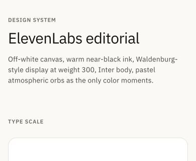

# Đánh giá frontend-next — 18/10/2026

> Cập nhật lần 2: đã có phiên đăng nhập và đã kiểm tra thêm kho tri thức có 20 tài liệu, chat có workspace văn bản, thư viện thành phẩm, preview, cài đặt chung/lưu trữ/skills/parser và quản trị dashboard/người dùng. Các phần ghi “chưa xác minh” bên dưới mô tả kết quả vòng đầu; bảng bổ sung cuối báo cáo cập nhật bằng chứng runtime. Không sửa mã ứng dụng.

## Phạm vi và mức xác minh

- Quét tĩnh 311 file `.ts`, `.tsx`, `.css` trong `app`, `components`, `lib`; thống kê 20 route và 152 file component. Đây là quét tìm mẫu và đọc các vùng liên quan, không phải kiểm chứng mọi trạng thái của từng component.
- BrowserView thực tế tại `http://127.0.0.1:3002`: đăng nhập, đăng ký, tạo workspace, design system. Kiểm tra desktop 1280px, mobile 390px và 320px; thêm màn hình thấp 390×320.
- Đã đọc CSS được trình duyệt biên dịch, computed styles và kích thước DOM. Theme đang phục vụ là Anthropic.
- Chat, kho tri thức, tài liệu, cài đặt và quản trị cần đăng nhập. Các kết luận về bố cục bên trong các màn hình này dựa trên mã nguồn, chưa được xác minh bằng ảnh của phiên đăng nhập.
- `npm run typecheck`: thành công, exit code 0. Không chạy production build hoặc kiểm thử chức năng backend.
- Chỉ tạo báo cáo và ảnh. Không sửa mã ứng dụng, không commit; giữ các thay đổi có sẵn.

## Các vấn đề ưu tiên

### 1. P1 — Hai cơ chế dark mode không đồng bộ

**Bằng chứng:** `components/settings/general-settings.tsx:26` bật/tắt lớp `html.dark`; `app/globals.css:62` sử dụng lớp đó để đổi token. Tuy nhiên CSS trình duyệt trả về các utility `dark:*` nằm trong `@media (prefers-color-scheme: dark)`. Không có khai báo `@custom-variant dark` trong CSS nguồn.

**Hệ quả:** chọn Dark trong ứng dụng khi hệ điều hành đang Light sẽ đổi token nhưng không đổi các màu `dark:*`. Trường hợp ngược lại cũng có thể tạo nền và chữ lệch chế độ. Ảnh hưởng chat, composer, toggle và tab tài liệu.

**Đề xuất:** đồng nhất variant Tailwind theo `.dark`; kiểm tra cả hai theme với bốn tổ hợp lựa chọn ứng dụng/hệ điều hành. Đây là thay đổi toàn cục, cần kiểm tra tác động trước khi sửa.

### 2. P1 — Nút primary mất tương phản trong ElevenLabs dark

**Bằng chứng mã nguồn:** `app/globals.css:72` đặt `--color-on-primary: #f5f5f4`, trong khi dòng 76 đặt `--color-primary: #f5f5f4`. `.btn-primary` dùng hai token này làm chữ và nền.

**Hệ quả:** chữ và nền giống nhau, tỷ lệ tương phản tính từ token là 1:1. Lỗi thuộc theme ElevenLabs dark; Anthropic dark đã đặt chữ primary màu tối nên không có lỗi token này.

**Đề xuất:** dùng màu chữ tối trên nền primary sáng trong ElevenLabs dark. Chưa bật theme này để chụp thực tế vì trang cài đặt yêu cầu đăng nhập.

### 3. P1 — Các utility màu đang được gọi nhưng không có token

**Bằng chứng:** quét nguồn tìm thấy `bg-surface` 23 vị trí, `bg-brand` 5, `text-brand` 9, `border-brand` 7, `bg-accent` 2, `text-accent` 2, `text-surface` 1. Không có token tương ứng trong hai stylesheet. Trình duyệt cũng không có rule cho các selector trần `.bg-surface`, `.bg-brand`, `.bg-accent`, `.text-brand`, `.text-accent`.

**Ví dụ rõ nhất:** `components/settings/skills-settings.tsx:492` dùng `bg-brand text-white` cho file đang chọn. Nếu nền brand không được tạo, trạng thái chọn có thể thành chữ trắng trên nền sáng. Thanh tiến độ ở dòng 383 cũng dùng `bg-brand`. Các nơi khác gồm parser, lưu trữ, memory, invitation và preview.

**Đề xuất:** thống nhất mapping về các token hiện có (`surface-card`, `primary`, `on-primary`) theo ngữ nghĩa từng nơi; chỉ tạo token mới khi có ý nghĩa thiết kế rõ ràng. Số lượng trên là vị trí văn bản trong nguồn, chưa phải số lỗi nhìn thấy ở runtime.

### 4. P1 — Grid tài liệu dựa trên viewport trong một cột rất hẹp

**Bằng chứng mã nguồn:** `components/kb-detail.tsx:628` giữ wiki rộng 440px từ breakpoint `lg`, 480px từ `xl`. Grid tài liệu ở dòng 698 đồng thời chuyển sang ba cột từ `lg`. Sidebar toàn ứng dụng rộng 264px; vùng chính thêm padding 80px và gap 24px.

**Tính toán tại viewport 1024px:** còn khoảng `1024 − 264 − 80 − 440 − 24 = 216px` cho grid. Ba cột với hai gap 12px chỉ còn khoảng 64px/card, trước padding nội bộ. Thanh tìm kiếm lại yêu cầu tối thiểu 180px.

**Đề xuất:** grid theo chiều rộng container hoặc `auto-fit/minmax`; wiki co giãn hoặc chuyển sang tab/drawer ở laptop nhỏ. Cần xác nhận bằng phiên đăng nhập tại 1024, 1100, 1280 và 1440px.

### 5. P2 — Cỡ chữ trong cài đặt không được áp dụng; theme chưa phục hồi đầy đủ

**Bằng chứng mã nguồn:** `components/settings/general-settings.tsx:99` chỉ ghi `--app-font-scale`. Toàn bộ nguồn được quét không có nơi đọc biến này. Nhiều kích thước chữ viết bằng px cố định. Effect dòng 65 chỉ khôi phục state từ localStorage, không áp dụng lại theme/cỡ chữ lên DOM. Boot script trong `app/layout.tsx` chỉ phục hồi preset `weknora_ui_theme`, không phục hồi `weknora_theme` hoặc `weknora_font_size`. Không thấy subscription theo dõi thay đổi màu hệ điều hành.

**Đề xuất:** khởi tạo preference tập trung trước paint, áp dụng lại sau reload và theo dõi system mode; cho typography thực sự sử dụng font scale. Xác nhận bằng thao tác chọn Large/Dark rồi reload, thay vì chỉ kiểm tra giá trị trong dropdown.

### 6. P2 — Menu thêm tài liệu có nguy cơ mở ra ngoài mép phải

**Bằng chứng mã nguồn:** nút thêm nằm trong nhóm `shrink-0` bên phải toolbar nhưng menu tại `components/doc-workspace/doc-workspace.tsx:805` dùng `absolute left-0 w-[320px]`. Các wrapper split pane dùng `overflow-hidden`.

**Hệ quả dự kiến:** menu mở từ cạnh trái của nút ở sát mép phải, phần lớn menu có thể tràn hoặc bị cắt bởi vùng chứa.

**Đề xuất:** neo menu vào `right-0`, giới hạn theo viewport hoặc dùng portal có tính toán collision. Cần kiểm tra ở cả chế độ split và màn hình nhỏ; đây chưa phải lỗi đã chụp runtime.

### 7. P2 — Minimum width trong settings vượt vùng nội dung nhỏ

**Bằng chứng mã nguồn:** `components/settings/input-limits-card.tsx:86`, `:116`, `:139` giữ `min-w-[260px]`. Ở mobile, modal có padding ngoài, vùng nội dung `px-5`, card `p-5`. Trên viewport 320px, vùng trong card còn khoảng 220px, nhỏ hơn minimum width 260px. Tại 640px, rail settings 260px cũng làm vùng nội dung bị thu hẹp đáng kể.

**Đề xuất:** `min-w-0`, `w-full` ở kích thước nhỏ; bố trí nhóm field theo chiều rộng container. Không ép cả modal cuộn ngang để bù cho lỗi bên trong.

### 8. P2 — Chữ phụ quá nhạt và thao tác cảm ứng nhỏ

**Bằng chứng trực quan và DOM:** nhiều caption trên trang mẫu rất nhạt. `muted-soft` trên trắng có tỷ lệ tương phản khoảng 2.52:1 ở ElevenLabs và 2.60:1 ở Anthropic, tính từ mã màu. Các nút mẫu cao 36px; `.btn-sm` cao 30px; nút composer có kích thước 28px. Input công khai dùng font computed 14px.

**Đề xuất:** dùng `muted` cho thông tin cần đọc, dành `muted-soft` cho trang trí; mở rộng vùng bấm của nút nhỏ trên thiết bị cảm ứng. Kiểm tra input 16px trên iOS thật để đánh giá hiện tượng tự zoom; BrowserView desktop chưa xác minh hành vi iOS.

### 9. P2 — Modal và drawer chưa quản lý focus đầy đủ

**Bằng chứng mã nguồn:** `components/modal.tsx` và `components/slide-panel.tsx` có Escape nhưng chưa có focus trap/khôi phục focus. Modal chưa có `aria-modal`. Drawer đóng chỉ dịch chuyển bằng transform; nội dung vẫn mounted và chưa có `inert`/ẩn khỏi accessibility tree khi đóng.

**Hệ quả dự kiến:** người dùng bàn phím có thể tab vào phần phía sau modal hoặc drawer đang đóng.

**Đề xuất:** tập trung hóa quản lý focus, khôi phục về trigger, vô hiệu hóa drawer đóng. Kiểm tra riêng nested settings/sub-page để tránh thay đổi luồng đang hoạt động.

### 10. P2 — Design system không phản ánh theme và type scale đang chạy

**Đã xác minh bằng BrowserView:** trang ghi “ElevenLabs editorial”, serif và bảng mã màu ElevenLabs, nhưng computed theme đang là Anthropic, font `IBM Plex Sans`. Nhãn `display-mega · 64/300` trong khi CSS desktop là 52px, mobile là 30px; `display-xl · 48/300` thực tế desktop 40px/mobile 28px. Các swatch cũng giữ mã hex tĩnh dù màu nền đi theo theme.

**Đề xuất:** trang mẫu đọc token/theme thực tế, hiển thị giá trị computed hoặc ghi rõ breakpoint, dùng ví dụ tiếng Việt. Đây là công cụ đối chiếu thiết kế nên cần chính xác trước khi chuẩn hóa các màn hình khác.

### 11. P3 — Mẫu chữ mobile bị bó thành cột hẹp

**Đã xác minh bằng ảnh:** tại 390px, mỗi dòng type scale dùng `flex ... gap-8` cộng caption `shrink-0`, khiến “The quick brown fox” bị xuống nhiều dòng; dòng đầu có từ “fox” đứng riêng. Không đo được tràn ngang ở 390px, nhưng phân bổ không gian thiếu cân đối.

**Đề xuất:** dưới `sm` chuyển mỗi mẫu sang bố cục dọc, caption xuống dưới; giảm padding card trên điện thoại. Tham khảo `design-mobile-viewport.jpg`.

## Những điểm đang làm tốt

- Khung chính dùng `h-dvh`, `min-h-0`, `min-w-0`, giúp hạn chế nhiều lỗi flex phổ biến.
- Modal chung đã giới hạn chiều cao theo `100dvh` và giới hạn chiều rộng; modal overlay được portal lên body.
- Sidebar đã có drawer mobile; settings đã có dropdown điều hướng mobile.
- Các bảng quản trị được đọc có wrapper `overflow-x-auto`; không coi việc bảng cuộn ngang là lỗi tự thân.
- Đăng nhập, đăng ký và onboarding giữ được lề ngang ở các kích thước mobile đã xem.
- Có xử lý reduced motion ở một số animation, focus-visible ở nhiều thao tác quan trọng.

## Thứ tự cải tiến đề xuất

1. Sửa nền tảng màu: dark variant, primary dark, utility/token không tồn tại.
2. Sửa các bố cục có nguy cơ mất nội dung: KB detail, menu tài liệu, minimum width settings.
3. Làm cho preference cỡ chữ/theme hoạt động và tồn tại sau reload.
4. Hoàn thiện contrast, vùng bấm, focus modal/drawer.
5. Cập nhật design system, sau đó cân lại spacing và typography giữa các màn hình dựa trên ảnh có dữ liệu thực tế.

Không nên đổi toàn bộ thẩm mỹ trước khi giải quyết các lỗi nền tảng này: hiện nhiều điểm thiếu đồng nhất xuất phát từ token và breakpoint, không phải cần một thiết kế mới.

## Kiểm tra còn cần phiên đăng nhập

| Nhóm | Kịch bản cần xác minh |
| --- | --- |
| Khung và cài đặt | Mở sidebar, account menu, settings; 320/390/640/768/1024px; nội dung dài; Tab/Escape |
| Chat | Conversation dài, tên file dài, attachments, mention, menu agent, streaming/error, bàn phím mobile |
| Kho tri thức | Wiki và grid tại 1024/1100/1280/1440px; loading/empty/error, nhiều tài liệu |
| Tài liệu | Split pane, menu thêm file, nhiều tab, preview, chuyển nguồn, landscape |
| Artifact | Nhiều filter, keyword dài, card đủ dữ liệu, mobile một/hai cột |
| Settings/admin | Input limits, skills chọn file, parser/storage, bảng dài, nested sub-page |
| Theme | ElevenLabs/Anthropic × Light/Dark/System; reload và thay đổi màu hệ điều hành |
| Embed/Word | Cần channel hoặc device flow hợp lệ để xem trạng thái thực tế |

## Ảnh bằng chứng

- `design-mobile.jpg`: toàn trang mobile 320px.
- `design-desktop.jpg`: toàn trang desktop 1280px.

Đánh giá này cung cấp danh sách lỗi và hướng cải tiến cụ thể. Việc kiểm tra trực quan toàn bộ khu vực đăng nhập vẫn còn mở; không coi các phát hiện từ mã nguồn là đã qua kiểm thử E2E.

## Bổ sung sau khi đăng nhập — kết quả kiểm tra thực tế

### 12. P1 — Danh sách tài liệu bị co về 0px trên điện thoại

**Đã xác minh:** kho tri thức thử nghiệm có 20 tài liệu, viewport 390×844. Header không co, vùng Wiki cố định `45vh`, gap 24px và wrapper ngoài `overflow-hidden` khiến vùng grid tài liệu có `clientHeight = 0`, dù `scrollHeight = 3185px`. Section tài liệu chỉ còn cao 0.91px, nằm từ y=827px. Người dùng không có vùng hiển thị để cuộn danh sách tài liệu.

**Bằng chứng:** `kb-detail-mobile.jpg`. Header cũng giữ nhóm action `flex gap-3` không wrap, khiến Upload/Chat tràn khỏi mép phải. Tabs phía dưới bị xuống nhiều dòng.

**Nguyên nhân:** `components/kb-detail.tsx` kết hợp header `shrink-0`, wiki `h-[45vh] shrink-0`, section tài liệu `flex-1 min-h-0` bên trong khung chiều cao cố định. Chỉ giới hạn chiều cao Wiki không đảm bảo còn đủ chiều cao cho danh sách.

**Ưu tiên sửa:** trên mobile dùng tab Tài liệu/Wiki hoặc cho toàn phần nội dung cuộn dọc, bỏ yêu cầu hai pane cùng chia chiều cao còn lại. Cho action bar wrap hoặc thu gọn. Tiêu chí đạt: nhìn và cuộn được tài liệu, truy cập được Chat/Upload tại 320/390px và màn hình landscape.

### Cập nhật phát hiện 4 — grid desktop đã được xác nhận

Tại 1024×768, Wiki rộng 440px từ x=304; grid bắt đầu x=768, rộng 289.92px và kết thúc x=1057.92, vượt viewport khoảng 33.92px. Ba cột đều rộng 87.30px. Số đo khác phép tính vùng khả dụng ở vòng đầu vì minimum content đẩy vùng grid ra ngoài khung. Ảnh `kb-detail-1024.jpg` xác nhận cột phải bị cắt. Tại 1280px, `kb-detail-1280.jpg` cũng cho thấy tên tài liệu và trạng thái bị ngắt/truncate quá mạnh.

### Cập nhật phát hiện 6 — menu thêm tài liệu đã được xác nhận

Tại 390px, bấm “Mở thêm văn bản” trong hội thoại có workspace tài liệu. Menu có x=105.5px, width=320px, right=425.5px: phần phải tràn 35.5px và bị cắt. Ảnh `document-menu-mobile.jpg`. Chỉ mở menu để kiểm tra; không tạo hoặc tải lên tài liệu.

### 13. P2 — Hai cột thành phẩm làm mất nhãn thao tác trên mobile

**Đã xác minh:** `app/platform/artifacts/page.tsx:317` giữ `grid-cols-2` ngay trên viewport 390px. Card rộng khoảng 169px; hai nút trong card chia ngang và `truncate`, khiến “Xem trước” và “Tải xuống” chỉ hiện “X…” và “T…”. Tên tệp, thời gian và tên hội thoại cũng đồng thời bị cắt mạnh.

**Đề xuất:** một cột ở mobile nhỏ, hoặc giữ hai cột nhưng đổi action thành hàng dọc/biểu tượng có nhãn truy cập rõ ràng. Ưu tiên một cột vì người dùng cần phân biệt nhiều tài liệu có tên gần giống nhau. Ảnh `artifacts-mobile.jpg`.

### 14. P2 — Header settings/preview thiếu bố cục riêng cho mobile

**Đã xác minh:** tab Công cụ lưu trữ trong settings giữ mô tả và nút “Thêm storage backend” cùng một hàng. Mô tả bị ép thành khoảng 5 dòng hẹp, tiêu đề cũng xuống hai dòng. Trang vector store có kiểu ép mô tả tương tự. Ở preview tệp, khi Open/Download xuất hiện, tên tệp trên header bị rút còn “D…”.

**Nguyên nhân:** header trong `components/settings/storage-settings.tsx:132` dùng `flex items-center justify-between` không wrap; `components/doc-preview-modal.tsx:136` đặt nhóm tên tệp và toàn bộ action cùng một hàng với padding 24px mỗi bên.

**Đề xuất:** mobile dùng header dọc, action ở hàng thứ hai; preview ưu tiên chỗ cho tên tệp, dùng nút icon có tên truy cập hoặc menu phụ. Đây là vấn đề phân bổ không gian, không chỉ cần giảm font.

### 15. P2 — Trạng thái Wiki tắt vẫn hiện như lỗi kỹ thuật và chiếm pane lớn

**Đã xác minh:** KB thử nghiệm chưa bật Wiki nhưng giao diện hiển thị `error code: 1000, error message: Wiki feature is not enabled for this knowledge base`, sau đó thêm “No wiki pages yet — they are generated after documents are indexed.” Nội dung vừa thể hiện feature tắt vừa gợi ý đang chờ tạo trang, trong khi vẫn dành 440–480px desktop hoặc 45vh mobile cho pane trống.

**Đề xuất:** dựa trên trạng thái feature để ẩn/thu gọn Wiki, hiển thị một thông báo ngắn đã dịch. Phân biệt trạng thái “chưa bật”, “chưa có trang” và “lỗi tải”. Ảnh kho tri thức desktop/mobile đã ghi lại cùng trạng thái.

### Quan sát bổ sung và giới hạn

- Workspace tài liệu báo không tải được script ONLYOFFICE từ dịch vụ nội bộ. Đã ghi ảnh `document-chat-mobile.jpg`; chưa kiểm tra thành công editor/iframe nên chưa đánh giá layout bên trong trình soạn thảo. Không quy lỗi tải dịch vụ thành lỗi CSS.
- Đã mở preview DOCX trong thư viện; giao diện trả về “Preview not available”. Chưa đủ bằng chứng kết luận đây là regression vì UI thông báo không hỗ trợ định dạng.
- Cài đặt chung mobile hiển thị vừa khung ở 390px; dropdown điều hướng hoạt động. Parser settings có nội dung dài nhưng không tìm thấy phần tử tràn ngang trong dialog tại kích thước này. Ảnh `settings-mobile.jpg`, `settings-desktop.jpg`.
- Quản trị người dùng dùng bảng rộng 1144px trong wrapper rộng 348px và cuộn ngang riêng; document vẫn rộng 390px. Đây là cách xử lý hợp lệ, có thể bổ sung gợi ý cuộn để dễ nhận biết.
- Không thay đổi theme hoặc font preference, không lưu cấu hình hệ thống, không upload/create/delete dữ liệu, không gửi tin nhắn chat trong quá trình kiểm tra. Những lỗi preference/dark đã kết luận từ mã nguồn/CSS biên dịch vẫn cần một vòng test thay đổi preference có phục hồi.
- Các màn hình đã kiểm tra có trộn Việt/Anh rõ ràng (Knowledge bases, Workspace, Settings, Upload, Open/Download, thông báo Wiki). Nên hoàn thiện i18n trước khi tinh chỉnh chiều rộng theo nhãn; nhãn dịch thường dài hơn và làm lộ các lỗi bố cục.

### Thứ tự xử lý cập nhật

1. Khôi phục khả năng xem danh sách tài liệu mobile và chặn tràn grid desktop.
2. Chặn menu/toolbar tràn màn hình.
3. Đồng bộ dark mode và sửa token màu/primary contrast.
4. Giữ nhãn thao tác rõ ràng ở thành phẩm và header mobile.
5. Sửa preference, focus, contrast và chuẩn hóa design system/i18n.

Tổng hiện có **15 nhóm phát hiện**; hai nghi vấn vòng đầu (grid desktop và menu tài liệu) đã được nâng thành lỗi xác minh bằng ảnh và số đo. Kiểm tra là visual audit trên các trạng thái hiện có, chưa bao phủ mọi role, dữ liệu, luồng nhập hoặc toàn bộ cấu hình theme.
