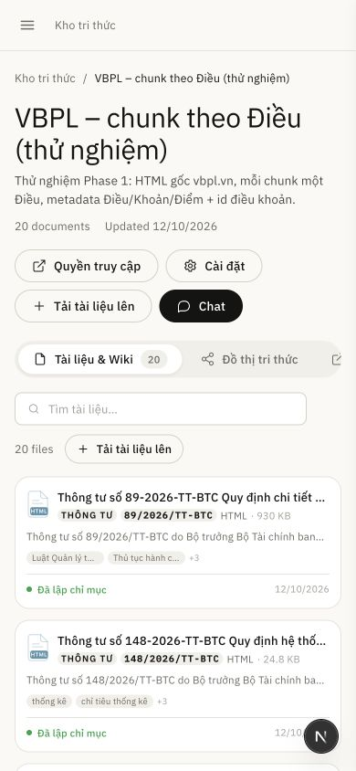
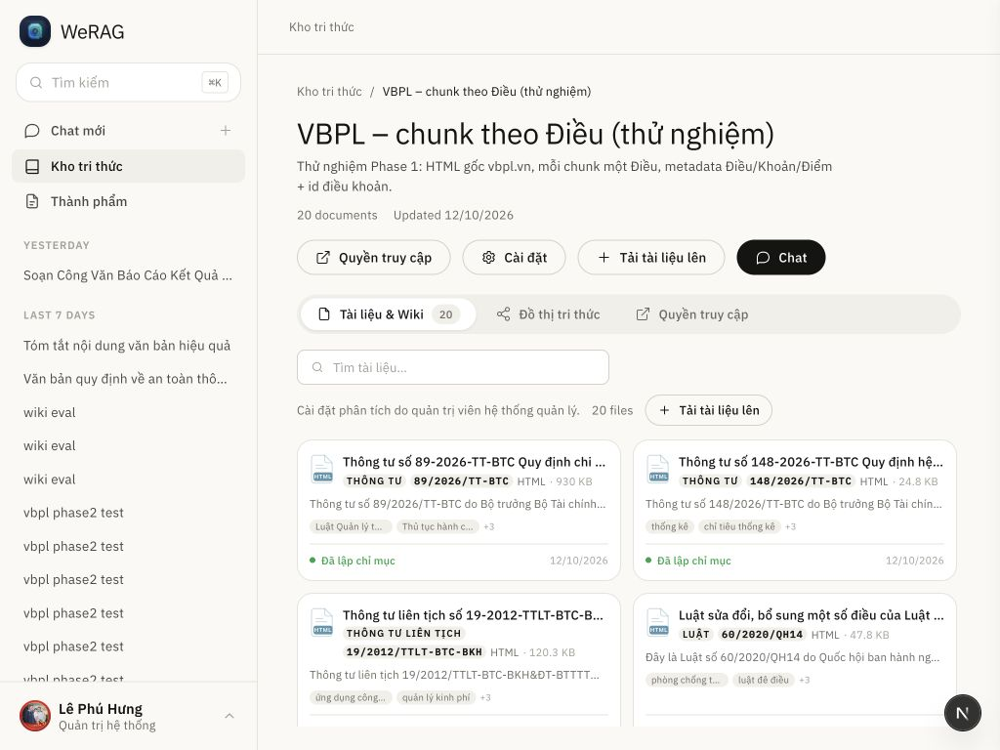
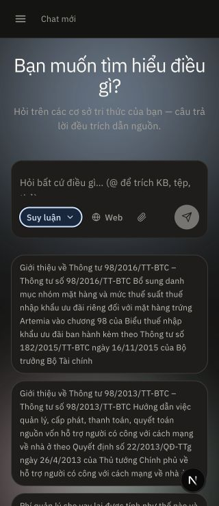
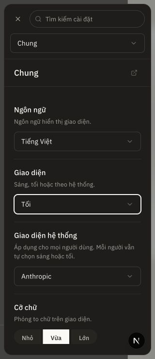
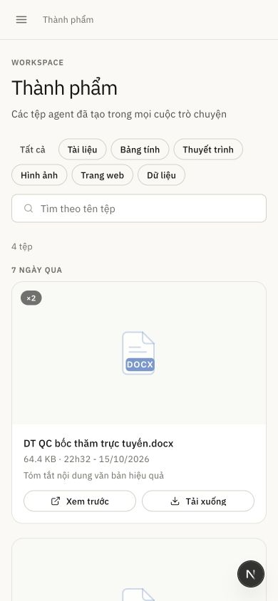
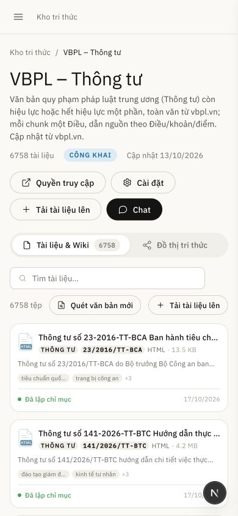
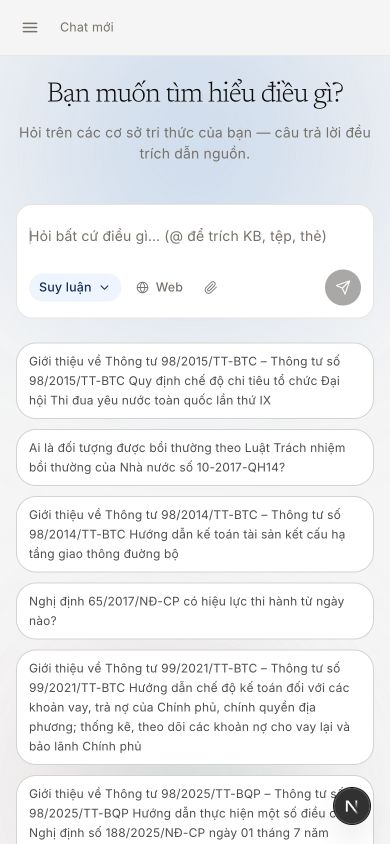
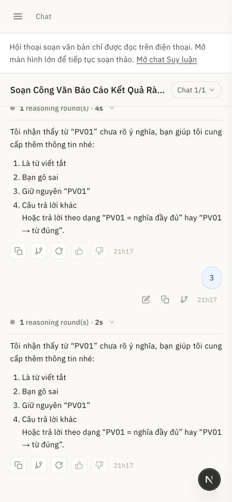
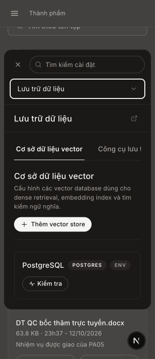
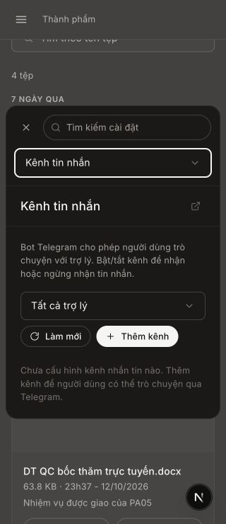

# Kết quả triển khai frontend-next UI — 18/10/2026

## Kết quả

Đã triển khai mã cho cả 7 hạng mục trong [kế hoạch](../../superpowers/plans/2026-10-18-frontend-next-ui-remediation.md). Typecheck, 406 unit test và build production thành công. Kiểm tra trực quan xác nhận lại được lỗi kho tri thức và card thành phẩm trong giai đoạn đầu triển khai; phần kiểm tra hình ảnh còn lại bị chặn do công cụ BrowserView từ chối quyền đọc URL localhost sau khi phiên công cụ được khởi tạo lại.

**Chưa thể coi toàn bộ ma trận visual/keyboard/touch là đã nghiệm thu.** Không dùng công cụ hay browser khác để vượt lỗi quyền này. Người dùng đã được thông báo và không cần tự tìm một cài đặt chưa xác định.

## Những gì đã thay đổi

| Nhóm audit | Thay đổi | Mức xác minh |
| --- | --- | --- |
| 4, 12: Kho tri thức desktop/mobile | Mobile cuộn cả trang và ưu tiên danh sách tài liệu; Wiki tắt không còn chiếm pane; toolbar wrap, tabs cuộn ngang. Desktop grid dựa trên container, Wiki co về 240–320px; giữ vùng nội dung tối thiểu 320px và cuộn ngoài khi header dài. | Đã thấy tài liệu mobile và grid desktop vừa khung; trường hợp header dài/Wiki bật cần xem lại sau sửa cuối. |
| 15: Wiki state | Không gọi Wiki khi `indexing_strategy.wiki_enabled === false`; field thiếu vẫn giữ khả năng tải. Error/empty loại trừ nhau, lỗi hiển thị thông báo dịch và Retry. | Typecheck/build; KB Wiki tắt đã xem bằng BrowserView. |
| 6: Menu tài liệu | Menu portal lên body, giới hạn chiều rộng, clamp theo viewport; Escape/click ngoài/scroll/resize đóng menu. | Mã đã sửa; chưa chụp lại menu sau sửa do BrowserView bị chặn. |
| 13: Thành phẩm | Một cột trên mobile; thumbnail 16:9, search toàn chiều rộng; action không dùng truncate để che lỗi bố cục. | Đã xem card một cột/search toàn chiều rộng; ảnh trước thay đổi thumbnail cuối. |
| 7, 14: Settings/preview | Header dọc trên mobile; tên file preview tối đa hai dòng, action hàng riêng; bỏ minimum width gây tràn trong input limits. | Typecheck/build; chưa xem lại tất cả trạng thái. |
| 1–3: Màu | Tailwind dark theo `.dark`; ElevenLabs dark primary có chữ tối; thay utility màu không có token bằng token có thật theo ngữ nghĩa. | Quét source không còn các utility màu đã báo cáo; kiểm tra CSS production có class-based variant. Ma trận hình ảnh hai preset chưa chạy đủ. |
| 5: Preference | Module riêng chuẩn hóa giá trị; boot trước paint, lưu/khôi phục mode/cỡ chữ; System theo OS và theo dõi thay đổi; có fallback khi storage bị chặn. | 7 test preference/theme pass; script production qua 32 tổ hợp sau minification. |
| 8: Typography và touch | Scale cỡ chữ mà không scale spacing/icon/canvas; input/placeholder rõ hơn; vùng bấm tăng trên pointer coarse. Mention overlay và textarea cùng font trên touch; tab tài liệu mở rộng để chứa các action 44px. | Typecheck/build, review mã; hình ảnh touch/OS thật cần xác minh. |
| 9: Focus | Overlay chung/settings/preview/drawer dùng stack focus; drawer đóng inert. Confirm, command palette và parser dialog đăng ký cùng stack; phục hồi trigger hoặc control khả dụng khi trigger biến mất. Palette portal lên body phía trên các dialog khác. | Review độc lập phát hiện lỗi overlay nằm trên và đã sửa. Chưa chạy lại keyboard runtime vì BrowserView bị chặn. |
| 10–11: Design system | Tên preset, màu, font-size/weight theo computed styles; tự cập nhật khi resize/theme/preference đổi. Mẫu tiếng Việt, layout mẫu chữ dọc trên mobile. | Typecheck/build; chưa có ảnh cuối. |

Các nhãn trong vùng đã sửa được bổ sung Việt/Anh: kho tri thức, tìm tài liệu/Wiki, số tài liệu, ngày cập nhật, trạng thái Wiki và preview. Không thay backend hoặc triển khai khả năng preview DOCX mới.

## Kiểm tra đã chạy

| Kiểm tra | Kết quả |
| --- | --- |
| `npm --prefix frontend-next run typecheck` | Exit 0, sau lượt sửa review. |
| `node --experimental-strip-types --test <45 file *.test.ts>` trong frontend-next | **406 pass, 0 fail, 118 suite**, sau lượt sửa review. |
| `next build --webpack` trên bản sao tạm với `WERAG_BACKEND_URL` lấy từ cấu hình dev thực tế | Exit 0; biên dịch, typecheck, prerender và route generation thành công. Không build đè `.next` của dev server. |
| Script preference lấy từ HTML production, chạy bằng Node VM với DOM tối thiểu | 32 tổ hợp: 2 OS × 4 theme (gồm invalid) × 4 font (gồm invalid) đều đúng. Đây là test script, không phải browser E2E. |
| CSS production | Có variant theo `:where(.dark…)` và các rule font scale. |
| `git diff --check` | Không lỗi whitespace. |
| GitNexus impact | Đã chạy trước sửa các symbol; phần lớn LOW. `OverlayModal` HIGH đã thông báo trước sửa; root/page entry có kết quả UNKNOWN được ghi lại, không suy diễn thành LOW. |
| GitNexus `detect-changes --scope unstaged --repo WeRAG` | Tổng working diff: 45 file, 72 symbol, 13 process, HIGH tại thời điểm chạy. Bao gồm thay đổi có sẵn và thay đổi song song ở auth; không đồng nghĩa toàn bộ thuộc task này. |

## Bằng chứng hình ảnh/DOM đã có

- **390×844:** grid tài liệu từ `clientHeight=0` thành vùng nội dung cao 3185px, mép phải 374px trong viewport 390px; các card đầu hiển thị và trang cuộn được.
- **1024×768:** KB có Wiki tắt hiển thị hai cột **332px + 332px**, grid kết thúc x=984px trong viewport 1024px. Trước sửa, cột chỉ 87px và grid kết thúc x=1057.92px.
- Thư viện thành phẩm đã chuyển sang một cột trên mobile và search toàn chiều rộng.

Ảnh ghi trong quá trình triển khai, trước lượt chỉnh focus/touch cuối:

## Review độc lập và lượt sửa cuối

Reviewer độc lập đọc diff so với baseline của task và xác định 5 vấn đề cụ thể; đã kiểm tra lại đường code và sửa trong một lượt:

1. Confirm/palette trên drawer/settings bị giành focus: đăng ký các overlay vào stack và portal palette lên lớp trên.
2. Overlay mention trên touch lệch textarea: cùng áp dụng công thức font-size cho hai lớp.
3. Action touch 44px vượt tab 36px: tăng kích thước tab tài liệu riêng trên pointer coarse.
4. Header KB desktop dài có thể làm grid cao 0px: cho cuộn ngoài và nội dung tối thiểu 320px.
5. Trigger unmount không có fallback: chọn control hiển thị ở trang khi không còn dialog cha.

Typecheck, full unit suite và production build sau lượt sửa đều thành công. Các test tự động hiện có không chứng minh được toàn bộ hình học và focus trong trình duyệt; những tình huống trên vẫn cần kiểm tra runtime.

## Quyết định triển khai và giới hạn

- Làm trên branch hiện có `feat/document-assistant`, giữ bản sao baseline từng file và không commit. Tránh tách khỏi trạng thái người dùng đang chỉnh; hệ quả là diff cần được review theo hunk và vẫn lẫn phần thay đổi có sẵn.
- Sửa CSS bằng ca lỗi BrowserView đã ghi làm baseline và đo DOM/ảnh ở các màn hình còn truy cập được; thêm unit test cho logic preference thay vì test snapshot chuỗi class. Các phần chưa đo lại phải giữ trạng thái “chưa xác minh trực quan”.
- Dùng stylesheet scale typography thay vì thay hàng trăm biểu thức JSX. Cách này giữ kích thước layout/icon và xử lý cặp overlay mention; khi thêm text utility mới cần kiểm tra rule scale tương ứng.
- Giảm thumbnail thành phẩm mobile về 16:9 sau khi chuyển một cột để tránh phần trang trí chiếm gần hết màn hình.
- BrowserView báo từ chối quyền URL; không tự chuyển công cụ, profile hoặc browser để vượt chặn. Vì vậy chưa hoàn thành ma trận 320/390/640/768/1024/1280/1440px, nested keyboard, touch, hai preset và iframe.
- ONLYOFFICE trước đó không tải được dịch vụ nội bộ. Không chỉnh endpoint hoặc tuyên bố editor đã hoạt động.
- Môi trường có thay đổi song song mới ở login/register/auth-shell trong khi task đang chạy; task này không sửa các file đó. Các thay đổi của người dùng được giữ nguyên.
- Không merge, push, tạo PR hoặc lưu preset theme toàn hệ thống. Chưa có commit của task này.

## Những bước xác minh còn lại

Khi BrowserView truy cập lại được, kiểm tra ưu tiên: menu tài liệu 320/390px; KB Wiki bật và header dài trên landscape; settings → Cmd/Ctrl+K và drawer → Confirm bằng Tab/Escape; font Large và mention trên touch; preview với tên tệp dài; hai preset × Light/Dark/System. Đọc ảnh mới và số đo trước khi đánh dấu các ca này pass.

## Bổ sung: gợi ý chat bị cắt chữ

- Ảnh người dùng cung cấp cho thấy các câu gợi ý dài bị cắt sau hai dòng. `CreateChatBody` áp dụng `line-clamp-2` cho cả gợi ý API và dự phòng, trong khi khung ngoài căn giữa và `overflow-hidden`.
- Đã bỏ giới hạn hai dòng, cho nút tự tăng chiều cao, ngắt từ dài và thêm focus outline. Khung nội dung không co, có khoảng đệm và cuộn dọc khi cao hơn màn hình; phần trang trí được giới hạn trong lớp riêng.
- GitNexus impact trước sửa `CreateChatBody`: LOW, một caller trực tiếp (`CreateChat`), không có process bị ảnh hưởng được index.
- Sau sửa: typecheck exit 0; toàn bộ 406 test / 118 suite pass; production build Webpack trong bản sao tạm exit 0; `git diff --check` pass. Chưa xác minh hình ảnh của thay đổi này.
- Chẩn đoán BrowserView: inventory của connector giữ các tab lỗi connection refused; tab hiện tại thực chất là tài liệu `data:text/html`, nên chính sách URL chặn trước khi điều hướng tới ứng dụng. Kiểm tra socket cục bộ xác nhận cả `127.0.0.1:3002` và `[::1]:3002` đang nhận kết nối. Đây chưa phải bằng chứng BrowserView đã kết nối lại.
- Đã hướng dẫn người dùng nhập lại URL HTTP trong thanh địa chỉ BrowserView và đăng nhập nếu cần. Không yêu cầu tắt bảo mật, không sửa chính sách hoặc chuyển công cụ để vượt chặn. Ma trận mobile/dark/keyboard vẫn chờ một tab HTTP hoạt động.

## Xác minh BrowserView sau khi người dùng mở lại tab

Tab HTTP mới `platform/creatChat` đã hoạt động và có phiên đăng nhập. Lỗi kết nối tab cũ đã được giải quyết bằng việc người dùng mở lại trang; không thay chính sách bảo mật.

- Chat mobile 390px: sáu nút gợi ý có clientHeight bằng scrollHeight (75–133px), không còn line clamp; mép phải 374px, document width 390px. 320px: clientHeight bằng scrollHeight (94–172px), mép phải 304px, document width 320px. Các câu nhiều dòng hiển thị đầy đủ và phần còn lại truy cập bằng cuộn.
- Dark mode Anthropic 320px: kiểm tra ảnh chat và settings; chữ, trường nhập, nút và focus outline nhìn rõ. Settings không tràn ngang.
- Settings: Shift+Tab từ Close vòng về Lớn; Tab từ Lớn vòng về Close. Cmd+K mở palette trên settings và giữ focus tại palette; Escape đóng palette, giữ settings và trả focus về Close.
- Palette trên chat: Escape trả focus về textarea; Tab từ textarea tới nút Suy luận, có viền focus.
- Thành phẩm 390px: một cột, bộ lọc xuống dòng, search đủ chiều rộng và hai action hiện rõ. Preview DOCX hiển thị trạng thái chưa hỗ trợ như thiết kế; Escape đóng và trả focus về Xem trước.
- Kho tri thức: ảnh mobile 390px có card tài liệu hiển thị. Đo document width bằng viewport tại 320/768/1024/1440px; không tràn ngang trang trong các ca này.
- Đã khôi phục theme Theo hệ thống, trợ lý Soạn thảo văn bản và reset viewport. Không gửi câu hỏi hoặc tạo tài liệu thử.

Ảnh sau xác minh:

Phạm vi chưa xác minh: thiết bị cảm ứng thật và bàn phím ảo, theme ElevenLabs trong phiên runtime này, ONLYOFFICE nội bộ, mọi tổ hợp trang/breakpoint. Các kết quả BrowserView phía trên thay thế trạng thái chờ kết nối của các ca tương ứng ở phần trước.

## Bổ sung ElevenLabs light/dark và giới hạn mobile

Người dùng yêu cầu kiểm tra phần còn lại và xác nhận cách xử lý: dưới 768px chỉ dùng Suy luận; hội thoại Word cũ chỉ đọc, tiếp tục soạn trên màn hình lớn.

### Thay đổi hành vi

- Policy mobile dùng `matchMedia(max-width: 767px)`, tự cập nhật khi resize. Chat mới chỉ có Suy luận; không hiện Word workspace. Không tự ghi đè lựa chọn agent desktop khi chỉ đổi viewport.
- Hội thoại Word được nhận diện bằng agent của chính session hoặc bằng tài liệu đang mở, không suy từ lựa chọn agent đã lưu của desktop. Ở mobile, history vẫn đọc/cuộn được; không có editor hoặc composer; các nút thao tác trong history bị vô hiệu hóa và có liên kết mở chat Suy luận mới.
- Chặn gửi vào hội thoại Word mobile ở handler; tự gửi câu hỏi đầu chờ tải session. Các lựa chọn handoff sang Word không còn thao tác được trên mobile; handler chặn trước khi tạo workspace/upload.
- Bộ chọn agent có role dialog, hỗ trợ Escape và vòng focus. Mở rộng lại desktop khôi phục khả năng soạn Word.
- Unit test policy kiểm tra cả phiên mới sau điều hướng và dữ liệu session khác với desktop preference. Cả hai ca hồi quy đã fail trước sửa rồi pass. Test lựa chọn làm rõ thông thường vẫn được giữ, lựa chọn handoff Word bị loại trên mobile.

### Lỗi giao diện phát hiện và sửa

| Lỗi quan sát | Sửa | Xác minh |
| --- | --- | --- |
| Bộ lọc được chọn dark có foreground `rgb(245,245,244)` trên nền trắng | Dùng cặp token `bg-ink text-on-primary` trong Thành viên, Từ viết tắt, Bộ nhớ cá nhân, Sandbox và Danh mục mô hình; sửa badge cùng mẫu | Đo lại bộ lọc Thành viên: chữ `rgb(23,20,18)` trên nền `rgb(245,245,244)`; đọc ảnh sau sửa |
| Thẻ PostgreSQL và nhà cung cấp web bị chồng tên/nhãn/nút ở 320px | Chia metadata và actions thành hai hàng mobile, wrap nhãn, ngắt URL dài | Ảnh sau sửa không chồng chữ, nút vẫn hiện đủ |
| Toolbar Kênh tin nhắn đẩy nút Thêm kênh khỏi màn hình | Filter đủ chiều rộng trên mobile; actions xuống hàng. Header Agents và action MCP cho phép xuống hàng | Mép phải nút Thêm kênh là 252.48px trong viewport 320px |
| Mở Bảo mật khiến password manager điền email vào tìm kiếm cài đặt, lọc hết navigation | Search input có kiểu search và autocomplete off; tách password form, thêm readonly username, khai báo current/new-password | Chỉ thêm autocomplete off chưa đủ; sau tách form, lặp lại Hồ sơ → Bảo mật và ô tìm kiếm vẫn rỗng; navigation còn đủ |

### Phạm vi BrowserView đã chạy

- Preset ElevenLabs được chọn qua UI, kiểm tra light và dark, sau đó khôi phục Anthropic. Theme cá nhân khôi phục Theo hệ thống, cỡ chữ Vừa.
- Đã mở đủ **23 mục cài đặt** ở **320px × light/dark**; lưu ảnh từng mục và số đo trong `elevenlabs-settings-matrix.json`. Khung modal có `clientWidth=scrollWidth=302px` ở mọi mục. Số đo này chỉ chứng minh khung ngoài không tràn; lỗi clipping nội dung được xác định thêm qua ảnh.
- Đọc ảnh các nhóm có form/card/table: Thành viên, Hồ sơ đơn vị, Lưu trữ vector/object, MCP, Agents, Kênh tin nhắn, Mô hình, Engine phân tích, Tìm kiếm web, Sandbox và Runtime. Bảng rộng giữ vùng cuộn riêng.
- Đã xem chat/gợi ý, thành phẩm và preview ảnh, KB có Wiki, đồ thị tri thức, danh sách KB và form tạo KB; kiểm tra mobile light/dark ở các ca nêu trong báo cáo. Đăng nhập/đăng ký có bố cục riêng, đã xem desktop/mobile light, không sửa auth-shell đang được chỉnh song song. Design system xác nhận ElevenLabs Light và Dark với cỡ chữ Lớn.
- Mốc **767px**: Word history có thông báo chỉ đọc, 0 textarea, 0 document tabs. Mốc **768px**: thông báo biến mất, 1 textarea và 1 document tabs. Sau sửa nhận diện session, mở lại Word ở 390px vẫn có thông báo và 0 textarea/document tabs.
- Chuyển chat mới đang chọn Word ở desktop sang 390px: tự dùng Suy luận; mở rộng lại vẫn chọn Word. Mobile picker chỉ có một lựa chọn Suy luận; Escape trả focus về trigger.
- Thực hiện một câu thử không chứa dữ liệu riêng: “Kiểm thử giao diện mobile: chỉ trả lời OK, không gọi công cụ.” Lần gửi đầu chuyển trang thành công, nhận “OK”, vẫn có composer Suy luận và không vào read-only. Hội thoại thử được giữ lại: `aa6154cb-5459-4fdb-8962-82ab52ef1d29` (tiêu đề “Kiểm thử giao diện người dùng di động”). Không tạo văn bản thử hoặc thay cấu hình dịch vụ.
- Đóng tab kiểm tra auth/design tạm; gọi reset viewport và trả tab chính về chat mới.

### Review và kiểm thử cuối

- Reviewer độc lập phát hiện lỗi phiên mới bị nhận nhầm Word, model overlay ghi đè lựa chọn và đường handoff Word trên mobile. Đã sửa cả ba. Reviewer xác nhận hai lỗi đầu đã được xử lý; đường handoff được bổ sung guard và regression test sau phản hồi cuối.
- **413 test pass, 0 fail, 118 suite**; typecheck exit 0; production build Webpack trong bản sao tạm exit 0. Bản sao được dọn sau build, không ghi đè `.next` của dev server. `git diff --check` pass.
- GitNexus impact trước sửa các component hiện có đều LOW trong lượt này, thông thường 1 caller; ChatProvider 2, Composer 3. Symbol policy mới chưa có trong index nên impact trả UNKNOWN, đã rà caller trực tiếp bằng source.
- GitNexus detect-changes của toàn working diff: **54 file, 91 symbol, 13 process, HIGH**; gồm thay đổi có sẵn, lượt sửa trước và auth song song. Không phải chỉ riêng follow-up này. Không commit/push/merge.
- Chưa xác minh thiết bị cảm ứng/bàn phím ảo thật, mọi trạng thái dữ liệu động và mọi trang iframe. ONLYOFFICE desktop vẫn báo không tải được API script dịch vụ nội bộ; không sửa endpoint/backend để né lỗi.

